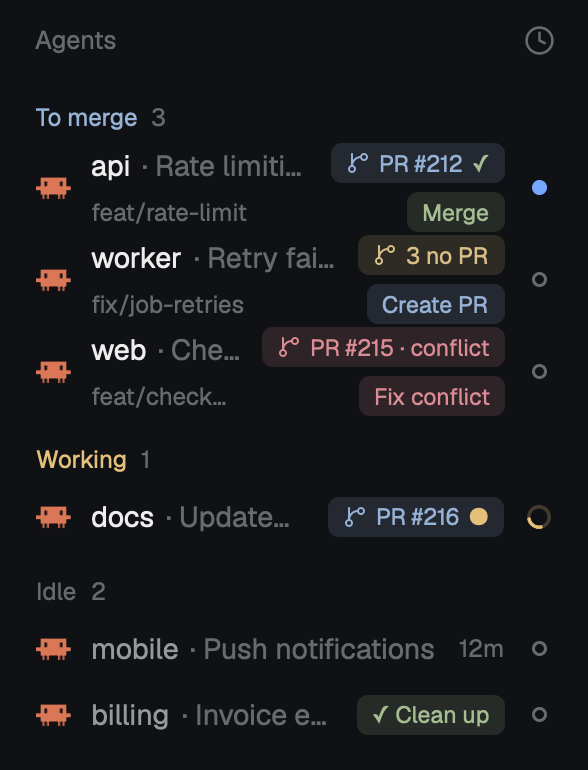

# herdr-por-mergear

A [Herdr](https://herdr.dev) layout whose Agents list shows which finished agents still have work to merge. Each one gets its PR, its CI state and a one-click next step: **Merge**, **Fix conflict**, **Create PR** or **✓ Clean up** for merged worktrees.



## Install

Paste this into an agent running inside Herdr:

```
Read ~/.config/herdr-app/AGENTS.md, then add this layout: https://github.com/linder3hs/herdr-por-mergear/tree/main/por-mergear
```

Your agent reads every file first and then switches to the layout. `ctrl-shift-l` takes you back to your own.

## What it runs

The mod runs `git` and `gh`, so you need the GitHub CLI, signed in. It types prompts into your agents with `hc send`, but only after you click a chip twice. Merging also takes two clicks. It never removes a worktree without Herdr's own confirmation dialog. [`RECIPE.md`](por-mergear/RECIPE.md) has the full brief.

## License

Apache 2.0. The `agents-merge` mod is a modified copy of the `agents` mod shipped with [Herdr](https://github.com/herdrdev/herdr-app), also Apache 2.0.
