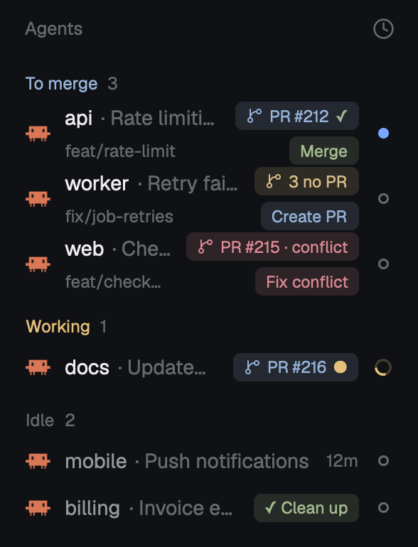

# Por mergear

Herdr's main window, but the Agents list knows what is still waiting to be merged. When an agent finishes, Herdr's own list moves it to Done whether or not its branch is on the base branch yet. This layout adds a **To merge** section for those agents. Each one shows its pull request or how many commits have no PR yet, and a chip with the next step: **Merge**, **Fix conflict** or **Create PR**. Agents whose PR is already merged get **✓ Clean up**, which removes their worktree.

## What you see

Everything outside the Agents list is Herdr's `main` layout as shipped in 0.1.12: spaces and agents in the left sidebar, tabs on top, panes as cards, Files and Changes panels, status bar.

The Agents list is Herdr's own list with these changes:

- **A "To merge" section.** In the Priority sort it sits between *Needs you* and *Done*. Its header uses the theme's `accent` color, like the other section headers, and shows a count. In the "Grouped by space" sort there's no section, but the chips still show on each row.
- **Two-line rows for agents in To merge.** These rows are 42px tall instead of 30px.
  - Line 1: the space name and the agent's title, as in the shipped list.
  - Line 2: the branch, 11px, `dim` color, truncated.
  - On the right, stacked and right-aligned, 4px apart: an info chip on top and an action chip under it.
- **Chips.** Each chip is 18px tall with 7px horizontal padding, 5px rounded corners and a 4px gap. Text is 10.5px semibold. The fill is the chip's color at about 15% alpha (`color + "26"`), and about 27% (`"45"`) on hover for clickable chips. They show:
  - **Info, PR open:** the `git-branch` icon, `PR #212` in `accent`, and the CI state after it: `✓` (`ansi2`) when checks passed, `✗` (`ansi1`) when they failed, `●` (`working`) while they run, nothing when the repo has no checks.
  - **Info, PR conflicting:** `PR #215 · conflict` in `ansi1`.
  - **Info, no PR:** `3 no PR` in `ansi3`, or `3 unmerged` when the repo has no `origin` remote.
  - **Merge** (`ansi2`): shown when the PR is mergeable and CI is neither failing nor running.
  - **Fix conflict** (`ansi1`): shown when the PR conflicts.
  - **Create PR** (`accent`): shown for commits without a PR in a repo with a remote.
  - **✓ Clean up** (`ansi2`): on a one-line row in its normal section, where the duration would be. Always visible, hover included.
- **Rows in other sections.** An agent still working on a branch with an open PR stays in Working, but shows its info chip in place of the duration.

## How it behaves

- **Statuses.** Working, blocked (Needs you), done and idle look and behave exactly as in Herdr's list. An agent moves to To merge only when it is done or idle and its branch has work that isn't merged:
  - **An open PR.** Info chip: `PR #n`.
  - **Commits not on the base branch and no PR.** Counted with `git rev-list --count <base>..HEAD`. Info chip: `n no PR`.
  - **Commits made after its PR was merged.** Counted from the PR's `headRefOid`. They show as `n no PR` again.
- **Clean up candidates.** An agent whose PR is merged, with no commits after it, in a linked worktree (not the main checkout), stays in its normal section with **✓ Clean up**.
- **Refresh.** Every 30 seconds and on load, the mod checks each local agent's pane: its cwd and branch with `git`, and its PR with `gh`. Agents on the base branch, on detached HEAD, outside git or on other machines are skipped.
- **PR info chip.** A click opens the PR in the browser (`gh pr view <n> --web`).
- **Merge, Fix conflict and Create PR need two clicks.** The first click changes the label to `Merge? click` and arms it for 4 seconds; a second click within that time runs it. These chips only show while the agent is done or idle.
  - **Merge:** runs `gh pr merge <n>` with the repo's allowed method. A merge commit is preferred, then squash, then rebase, read from `gh repo view`. While it runs the chip reads `Merging…`. Afterwards a toast says `PR #n merged`, or `Couldn't merge PR #n` with gh's first error line.
  - **Fix conflict:** types a prompt into the agent with `hc send`. The agent brings in the base branch, resolves the conflicts, checks the build and pushes, without merging.
  - **Create PR:** types a prompt into the agent with `hc send`. The agent pushes and opens the PR with `gh pr create`, without merging.
- **✓ Clean up (one click).**
  - It opens Herdr's own worktree dialog with `{space, folder, action: "remove"}`. That dialog closes the agent's space and runs `git worktree remove`, warning first about uncommitted changes.
  - If the space has terminals outside that worktree, nothing is removed and a warning toast explains why.
  - The branch and the remote are left alone.
- **Optional Trello step.** With `TRELLO = true` at the top of `main.js`, after a successful merge the agent is asked to move the matching Trello card to done with a comment, and to ask first if it isn't sure. This needs a Trello MCP in that agent. It is off by default.

## Built from

- **Layout `layouts/por-mergear.json`:** a clone of Herdr's `main` (version 0.1.12, `cloned_from` recorded). The only change is the `agents` block in the sidebar: its `content.mod` is `agents-merge` instead of `agents`.
- **Mod `mods/agents-merge/`:**
  - It is a clone of the shipped `agents` mod (`mod.clone`), with `place: "none"`.
  - The sort popup opens `{ mod: "agents-merge", props: { sortMenu: true } }`.
  - **Additions:**
    - `MERGE = 3.5` in the rank table, labelled "To merge".
    - `rank()` returns it for done or idle agents with `pr` or `local` merge state.
    - `checkMerge()` builds `this.merge`. Each address maps to `{kind: "pr" | "local" | "merged", …}`.
    - `repoOf(cwd)` caches per cwd: `git rev-parse --git-common-dir` for the main checkout, `origin/HEAD`, else `origin/main`, else `main` for the base, `git remote get-url origin`, and `--show-toplevel`.
    - `prsOf(main)` makes two `gh pr list` calls per repo per check. Open PRs come with `statusCheckRollup` and `mergeable`. All states come with `--limit 400`, newest PR per branch.
    - Chips are built by `chip()`, `confirmChip()`, `info()` and `action()`.
  - **Herdr API it uses:** `agents()`, `panes()` (cwd and branch), `spaces()`, `exec`, `hc(["send", address, text])`, `notify`, `openOverlay` (shipped `worktree` dialog) and `cx.timer.every` / `cx.timer.after`.
  - **Programs it runs:** `git` and `gh` (the GitHub CLI, signed in).
  - **Art:** `mods/workspace-chrome/git-branch.svg`.

## Watch out

- **The shipped `main` is read-only.** That's why this is a layout and not just a mod: the Agents block has to point at the clone. Being clones, neither the layout nor the mod gets Herdr's later updates to `main` or `agents`.
- **A row's hover shows the pin button.** Don't hide the Clean up chip on hover, or it disappears before you can click it.
- **Don't pass only `{space, action}` to the worktree dialog.** Its folder then falls back to the space's first pane. Pass `folder` too, and only when every pane of that space is inside the worktree, because the dialog closes the whole space.
- **The 400-PR window.** A branch whose PR is older than the last 400 shows as `no PR`.
- **Stale counts.** `<base>..HEAD` uses the local `origin/<base>` ref. A long-unfetched base can inflate the count.
- **Durations reset.** The clone keeps its own `localStorage`, so durations start over the first time it runs.
- **Scope.** It only looks at agents on this machine (addresses without `machine/`). It needs `gh` signed in for the GitHub parts. Without `gh` every branch reads as having no PR.

## Done when

- `herdr-app check mods/agents-merge` passes, `layout.switch {"name":"por-mergear"}` shows the window, and `herdr-app status` has no errors.
- Branches go to the right place:
  - An idle agent on a branch with an open, mergeable PR is under **To merge** with `PR #n` and a **Merge** chip.
  - A conflicting PR shows `PR #n · conflict` and **Fix conflict**.
  - A branch with commits and no PR shows `n no PR` and **Create PR**.
- One click on **Merge** shows `Merge? click`. It reverts after 4 seconds. Two clicks merge the PR and a success toast appears.
- An agent in a linked worktree whose PR is merged shows **✓ Clean up** on hover too. Clicking it opens Herdr's remove-worktree dialog for that folder.
- An agent on the base branch, or outside git, looks exactly as in Herdr's own list.
